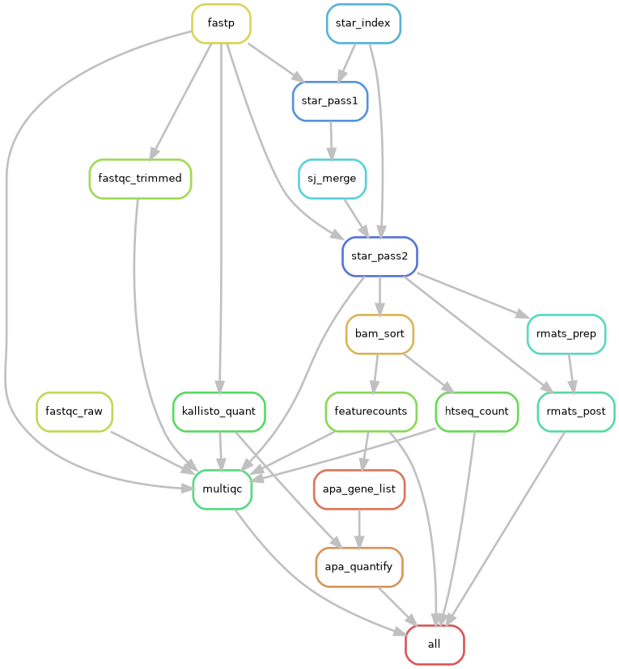

# TRIDENT

A Snakemake pipeline that takes paired-end bulk RNA-seq FASTQ files and
quantifies three layers of transcript regulation:

| Layer | Tools | Main output |
|---|---|---|
| Gene expression | STAR, featureCounts, htseq-count | gene × sample count matrix |
| Alternative splicing | rMATS | per-sample PSI and read counts for SE, MXE, A3SS, A5SS and RI events |
| Alternative polyadenylation (3′ UTR isoforms) | kallisto, apatools | per-sample proximal/distal isoform counts and PUD/RUD/DUD |



## Quick start

**1. Install** (needs conda >= 23 or mamba):

```bash
git clone https://github.com/simon-s-tang/TRIDENT.git
cd TRIDENT
bash create_environment.sh      # creates the `trident` conda environment
conda activate trident
```

**2. Describe your dataset.** These are the only files you edit:

```bash
cp -r config/example_dataset config/my_dataset
```

- `config/my_dataset/config.yaml`: reference genome and GTF, STAR index
  folder, 3′ UTR reference (or `modules: {apa: false}`), paths of the two
  sheets below, read length, strandedness, adapters. Use absolute paths.
- `config/my_dataset/samples.tsv`: one row per sample.
- `config/my_dataset/units.tsv`: the FASTQ files, one row per sample and lane.
  `workflow/scripts/make_sample_sheets.py` builds both sheets from a FASTQ
  folder.

Leave the defaults file, `config/config.yaml`, unchanged: to change a default
(a tool option, threads, memory), add the same key to your dataset config.

**3. Run:**

```bash
snakemake -n --configfile config/my_dataset/config.yaml --directory <run folder>   # dry run
snakemake --configfile config/my_dataset/config.yaml --directory <run folder> --cores 16
snakemake --configfile config/my_dataset/config.yaml --directory <run folder> --report report.zip
```

## Steps

1. **Preprocess:** fastp adapter trimming; FastQC on raw and trimmed reads.
2. **Align:** STAR index; STAR pass 1; junctions pooled across samples; STAR pass 2.
3. **Expression:** featureCounts and htseq-count; one MultiQC report for the run.
4. **Splicing:** rMATS `prep` per sample, then one `post` over all samples with `--statoff`.
5. **APA:** kallisto index of the 3′ UTR windows (built if missing); kallisto on each sample; reliably expressed genes from the gene counts; apatools filters the isoform counts and pairs each gene's proximal and distal isoforms.

## Configs

Two files, described in [config/README.md](config/README.md):

- `config/<dataset>/config.yaml` (yours): the dataset, with no defaults. It can
  override any default.
- `config/config.yaml`, the defaults (don't edit): every tool option, each
  rule's threads, memory and run time, and the `modules` switches
  (`expression`, `splicing`, `apa`).

Unknown keys are rejected, so a typo stops the run with an error.

## 3′ UTR reference (APA module)

Standard annotations such as GENCODE don't list a gene's alternative
polyadenylation (PA) sites as separate 3′ UTR isoforms, so the APA module needs
its own reference of **tandem 3′ UTR isoforms**: one isoform per PA site, all
sharing the same 3′ UTR start. A gene's shortest isoform is its *proximal* one;
the longer ones are *distal*. Give two GTFs in the dataset config:
`gtf_no_focus`, the isoforms, and `gtf_focus`, the windows that are counted
(the last 300 nt before each PA site). TRIDENT builds the kallisto index of the
windows from `gtf_focus` and the genome if `kallisto_index` does not exist yet.
For details, see https://github.com/idiap/apatools and the test data. Without
such a reference, set `modules: {apa: false}`.

## Running on a cluster

TRIDENT does not depend on a scheduler: a Snakemake
[executor plugin](https://snakemake.github.io/snakemake-plugin-catalog/)
submits its jobs to your cluster. For SLURM, install the plugin into the
environment:

```bash
conda install -n trident -c bioconda snakemake-executor-plugin-slurm
```

Then create a **profile**: a file of settings for your cluster that Snakemake
reads at the start of a run. With it, Snakemake submits each job as soon as the
jobs it depends on have finished, up to a maximum number at a time, and SLURM
runs each job on a node with the cores, memory and run time it asked for. These
come from each rule's `threads`, `mem_mb` and `runtime` in
`config/config.yaml`; the profile adds what is specific to your cluster, such
as the partition and account. Some clusters also limit the memory per core (for
example 7 GB) and reject jobs that ask for more, so the profile can give those
rules more cores, or send them to a partition with more memory per core.

For example, `~/.config/snakemake/trident_profile/config.yaml`:

```yaml
executor: slurm                 # submit jobs with sbatch
jobs: 50                        # at most 50 jobs submitted at a time
latency-wait: 60                # seconds to wait for a job's output files to appear
default-resources:              # for every job
  slurm_partition: <partition>
  slurm_account: <account>
set-threads:                    # more cores where memory per core is limited, or your data requires it
  htseq_count: 2
  apa_quantify: 3
  star_index: 13
set-resources:                  # other per-rule changes
  star_index:
    slurm_partition: <e.g. partition with more memory per core>
```

Snakemake needs to keep running while the jobs run, so to use Snakemake's executor 
plugin, start it in `tmux` (or `screen`) to keep it running after you disconnect. 
Detach with `Ctrl-b d` and reattach with `tmux attach -t trident_profile`:

```bash
tmux new -s trident_profile
conda activate trident
snakemake -n --profile trident_profile --configfile config/my_dataset/config.yaml --directory <run folder>   # dry run
snakemake --profile trident_profile --configfile config/my_dataset/config.yaml --directory <run folder>
snakemake --configfile config/my_dataset/config.yaml --directory <run folder> --report report.zip
```

Other schedulers have their own plugins (LSF, HTCondor; PBS and SGE through
`cluster-generic`).

## Outputs

Under `results/` in the run folder; logs in `logs/`:

| Module | Files |
|---|---|
| expression | `expression/featurecounts/feature_counts.txt`, `expression/htseq/{sample}_counts.txt`, `multiqc_report.html` |
| splicing | `splicing/rmats/{SE,MXE,A3SS,A5SS,RI}.MATS.{JC,JCEC}.txt`, `individualCounts.*.txt`, `sample_order.txt` |
| apa | `apa/apatools/table_of_pairs.csv`, `apa/apatools/df_counts_filtered_corrected_normalized.csv`, `apa/apatools/Figures/`, `apa/kallisto/{sample}/abundance.tsv` |

rMATS writes per-sample values as unnamed comma-separated lists; their order
is in `sample_order.txt`. Because all samples are processed together with
`--statoff`, any two groups can be tested afterwards with rMATS's
`prepare_stat_inputs.py` and `rmats.py --task stat`.

## Testing

`.test/` holds a 2 Mb slice of GRCh38 chr12 with its GENCODE v49 genes and 3′
UTR reference, and simulated reads for four samples
(`.test/make_test_data.py`). It runs every module in a few minutes:

```bash
snakemake --configfile .test/config/config.yaml --directory .test --cores 4
```

## Citations

To cite this pipeline, please cite the following publication:

"to insert link here"

## Licence

GPL-3.0 (see `LICENSE`).
